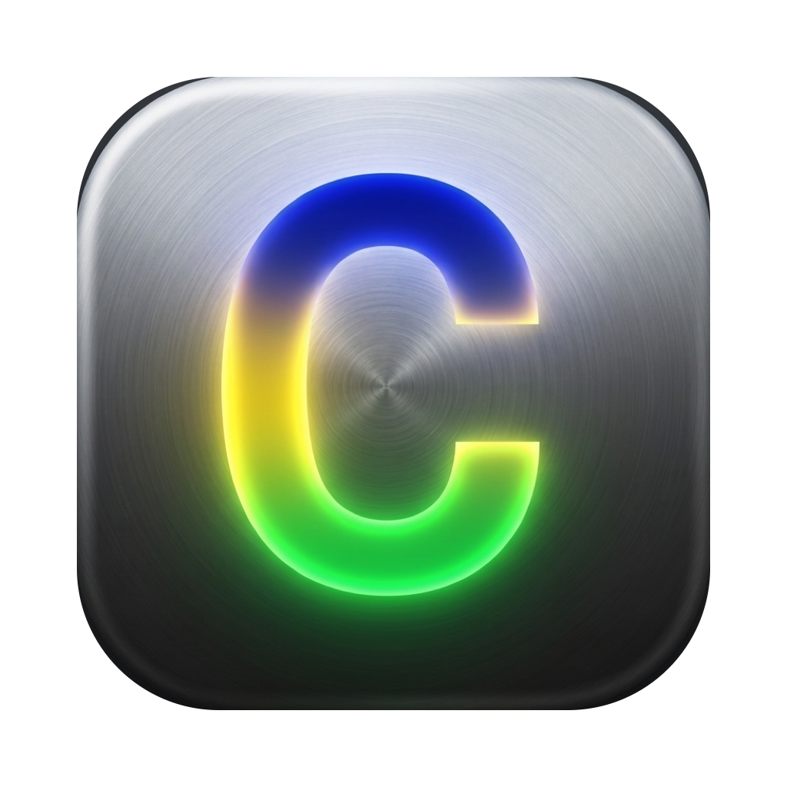
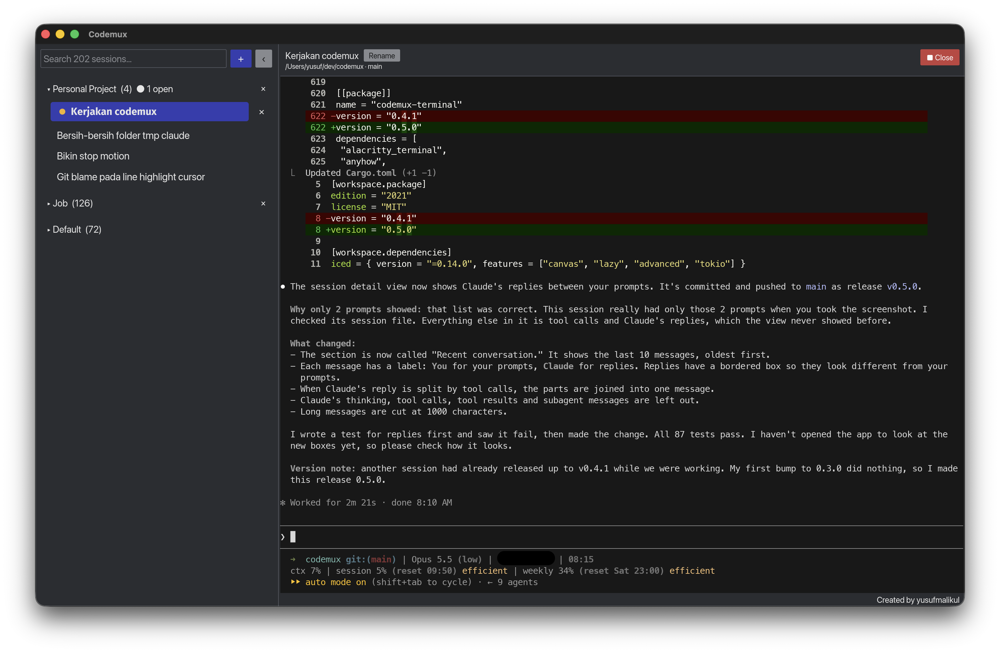

<p align="center"></p>

# codemux

A desktop session manager for Claude Code.



> **Note:** codemux is a personal tool. I build it for my own daily use, so it follows my own needs and habits.
> I do not plan to support other setups or take feature requests.
> If you want to use it, please fork it and change it to fit your needs with your own AI coding agent (such as Claude Code).

One window: a sidebar with all your Claude Code sessions on the left, and the session's terminal on the right.

## Why

Claude Code saves every session in `~/.claude/projects/`, and you can reopen one with `claude --resume <id>`.
But after a restart, your terminal tabs are gone, and it is hard to remember which sessions were open.

codemux keeps that list for you:

- Shows every session in a sidebar, grouped by time, and in workspaces you create.
- Shows which sessions are working, which are waiting for input, and which are old.
- Runs Claude Code in a real terminal inside the app.
- After a restart, the sessions that were open come back, and you can resume each with one click.

codemux never sends your session files anywhere and never calls the Claude API.

## Build and run

You need [Rust](https://rustup.rs) (stable) and the `claude` CLI on your `PATH`.

```sh
cargo run --release -p codemux
```

On macOS, install it as an app, so you can open it from Spotlight (Cmd+Space, type "codemux"), Finder, or Launchpad:

```sh
./scripts/install-macos.sh
```

Run the script again after you pull changes, to update the app.

Run the tests:

```sh
cargo test
```

## Project layout

| Crate | What it does |
|---|---|
| `crates/core` | Reads session files, tracks status, stores app state. No UI. |
| `crates/terminal` | Terminal widget for [Iced](https://iced.rs), built on `alacritty_terminal`. |
| `crates/app` | The desktop app (sidebar, tabs, settings). |

See [SPEC.md](SPEC.md) for the full design.

## License

MIT. See [LICENSE](LICENSE) and [NOTICE](NOTICE). The terminal crate includes code from
[iced_term](https://github.com/Harzu/iced_term) (MIT).
